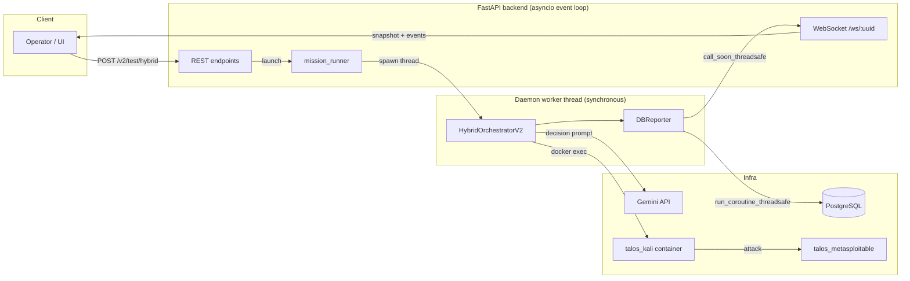
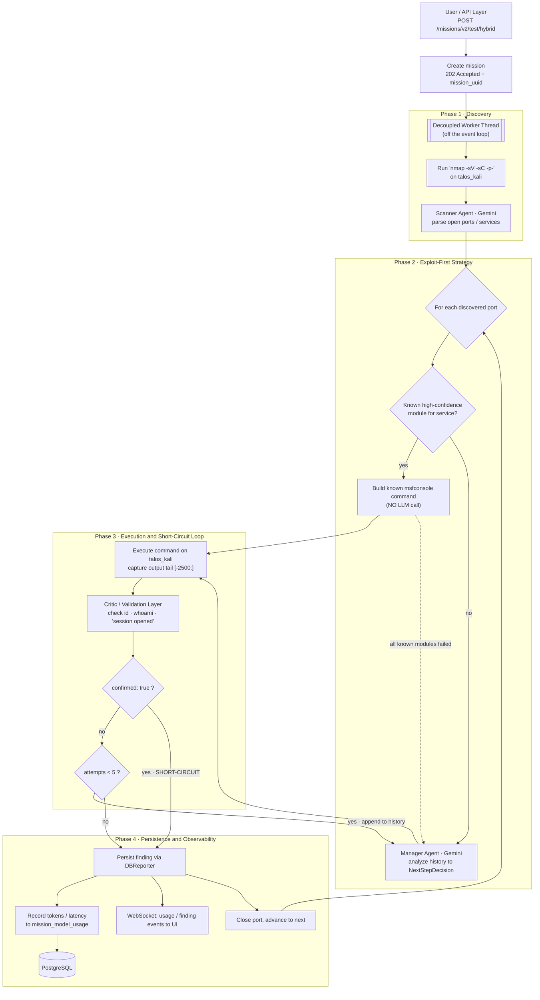
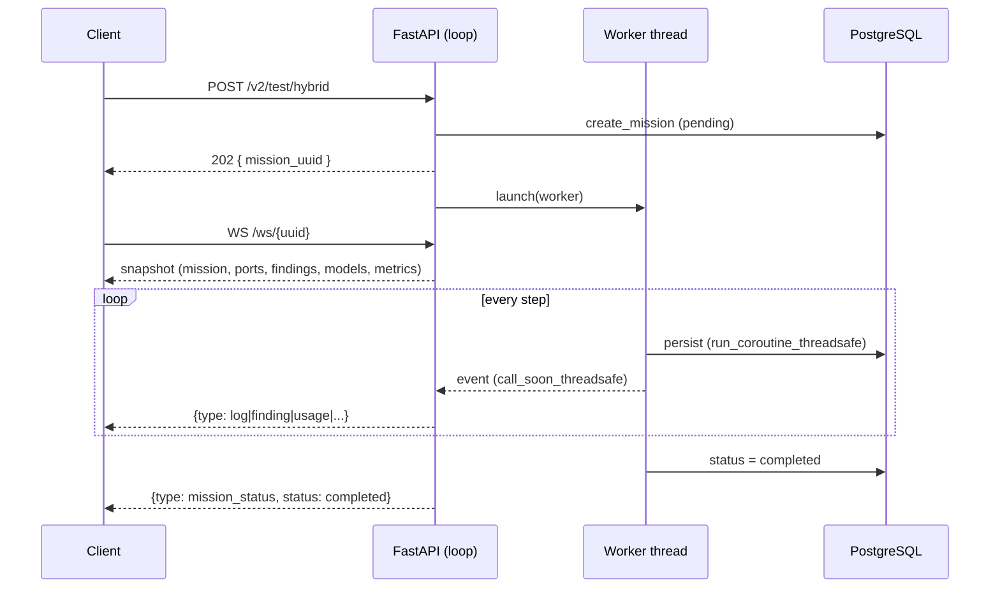
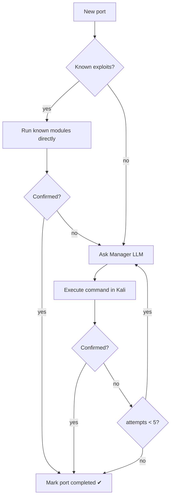

<a id="arch-top"></a>

<p align="left">
  <a href="./index.md">← Documentation</a> 
</p>

# `Architecture`

TalosAI is an **agentic penetration-testing platform** that drives real security
tooling inside a sandboxed Kali Linux container through a deterministic,
iterative reasoning loop. This document details the V2 architecture: the
decoupling between the FastAPI backend, the asynchronous worker thread and the
WebSocket telemetry channel, the *Exploit-First + Short-Circuit* control loop,
and the evidence Validation Layer that confirms every finding.

## Table of Contents
- [1. System Overview](#1-system-overview)
  - [End-to-End Operational Workflow](#end-to-end-operational-workflow)
  - [Performance (last reference mission)](#performance-last-reference-mission)
- [2. Execution Decoupling](#2-execution-decoupling-api--worker--websocket)
- [3. The Orchestrator V2 Loop](#3-the-orchestrator-v2-loop)
- [4. Exploit-First + Short-Circuit](#4-exploit-first--short-circuit)
- [5. The Validation Layer](#5-the-validation-layer-evidence-confirmation)
- [6. Universal Usage Tracking](#6-universal-usage-tracking-finops)
- [7. Resilience & Fault Tolerance](#7-resilience--fault-tolerance)

---

## 1. System Overview

TalosAI follows a **manager/executor** paradigm rather than a free-form ReAct
agent. A cloud reasoning model (Google Gemini) acts as the *Lead Pentester*
("Manager"), deciding the next action; a local, non-LLM *Executor* runs the
resulting command verbatim inside the Kali container via the Docker Engine API.
The loop is **bounded and deterministic**: a fixed per-port attempt budget
guarantees termination, and known-exploit modules are attempted deterministically
before any model call.



| Component | Role | Technology |
|-----------|------|------------|
| REST API | Mission lifecycle (create, resume, cancel, read) | FastAPI, async |
| Worker thread | Runs the synchronous orchestrator off the event loop | `threading.Thread` (daemon) |
| Orchestrator V2 | Discovery + per-port attack loop | Python, Gemini |
| Executor | Runs commands inside Kali | Docker Engine API (`exec_run`) |
| `DBReporter` | Durable persistence + live fan-out | asyncpg, `asyncio.Queue` |
| WebSocket | Real-time reasoning/findings/usage stream | FastAPI WebSocket |

### End-to-End Operational Workflow

The diagram below traces a mission end to end, from the HTTP request through the
four operational phases — Discovery, Exploit-First strategy, the Execution /
Short-Circuit loop, and Persistence / Observability.



### Why this flow works

- **Event-loop ⇄ worker decoupling.** The blocking orchestrator (synchronous
  `docker exec`, throttled Gemini client) runs in its own daemon thread, so the
  API answers `202` instantly and the FastAPI event loop never stalls. State and
  telemetry cross back to the loop through the single `DBReporter` sink
  (persistence via `run_coroutine_threadsafe`, live events via
  `call_soon_threadsafe`).
- **Defensive tail truncation.** Captured output is stored as its last ~2500
  characters (`[-2500:]`), not the first. For `msfconsole` the proof of
  compromise (`session opened`, the `whoami; id; uname -a` result) lands at the
  *end* of verbose output — keeping the tail preserves exactly the evidence the
  Validation Layer and the reviewer need, instead of discarding it.
- **Exploit-First.** Known high-confidence modules are run deterministically
  *before* any model call; on a confirmed hit the port short-circuits with
  **zero Manager invocations**. The LLM is a fallback reasoner, invoked only when
  deterministic knowledge is absent or exhausted — the main lever for both speed
  and token economy.

### Performance (last reference mission)

Reference run against a *metasploitable* target (`orchestrator_version: v2`,
`status: completed`). The mission investigated **25 ports** across **38
exploitation attempts** and produced **11 confirmed** compromises (each backed by
real execution proof such as `uid=0(root)`).

A key efficiency indicator is how little of the wall-clock is spent waiting on
the model: aggregate **LLM latency was 78.5 s out of a 25:08 mission — ~5.2 %**.
The remaining ~95 % is real tool execution (full-port Nmap, Metasploit) inside
Kali.

| Agent (role) | Model | Provider | Prompt | Completion | Total | Calls | LLM latency (s) |
|--------------|-------|----------|-------:|-----------:|------:|------:|----------------:|
| **scanner** (Nmap parsing) | `gemini-3.1-flash-lite-preview` | gemini | 5,077 | 1,081 | 6,158 | 1 | 3.34 |
| **manager** (attack decisioning) | `gemini-3.1-flash-lite-preview` | gemini | 40,166 | 6,391 | 46,557 | 45 | 75.16 |
| **Total** | — | — | **45,243** | **7,472** | **52,715** | **46** | **78.50** |

| Mission-level metric | Value |
|----------------------|------:|
| Total duration (`metrics.duration`) | `00:25:08` (1,508.2 s) |
| Aggregate LLM latency | 78.5 s |
| LLM latency share of wall-clock | ~5.2 % |
| Total LLM calls | 46 |
| Ports investigated | 25 |
| Confirmed vulnerabilities | 11 |

> The data above is read directly from the mission's `models` and `metrics`
> blocks (see [`last_mission_results.json`](./last_mission_results.json)), the
> same shape returned by `GET /talos/api/missions/{uuid}`.

---

## 2. Execution Decoupling (API ⇄ Worker ⇄ WebSocket)

The orchestrator is **fully synchronous** (blocking `docker exec`, `time.sleep`
throttling, a synchronous Gemini client). Running it on the FastAPI event loop
would stall every other request, so each mission executes in its **own daemon
thread**. `POST /v2/test/hybrid` therefore persists the mission, returns
`202 Accepted` with the `mission_uuid` immediately, and hands execution to the
background worker.

Two channels cross the thread boundary back onto the main asyncio loop, through
a single `DBReporter` sink:

- **Durable state** — DB writes are marshalled with
  `asyncio.run_coroutine_threadsafe(coro, loop).result()`, reusing the async
  `asyncpg` pool. Every reasoning step, discovered service, finding and status
  change is committed the moment it happens.
- **Live telemetry** — events are pushed with
  `loop.call_soon_threadsafe(_broadcast, …)` onto **per-mission subscriber
  queues**. The `/ws/{mission_uuid}` handler subscribes *before* reading the DB
  snapshot (so no event is lost in the gap), sends a full snapshot, then streams
  incremental events until the mission reaches a terminal state.

This design makes a mission simultaneously **durable** (survives a crash,
resumable) and **observable** (streamed live), without ever blocking the API.



---

## 3. The Orchestrator V2 Loop

`HybridOrchestratorV2.run()` executes two phases:

1. **Service Discovery.** A single comprehensive scan
   (`nmap -sV -sC -p-`) enumerates services on all ports. The raw output is
   parsed into a structured service roster (`port`, `service_name`, `version`)
   and persisted immediately, so a crash right after discovery still leaves a
   resumable mission.
2. **Per-Port Attack Loop.** Each service is investigated under a **bounded
   budget** (`attempts < 5`). On each iteration the Manager (Gemini) is given the
   port context and the full history of what has been tried, and returns a
   structured `NextStepDecision`:

   ```text
   action ∈ { SEARCH_EXPLOIT, EXECUTE_ATTACK, NEXT_PORT, COMPLETED }
   target_port, specific_command, reasoning
   ```

   `EXECUTE_ATTACK` commands are run verbatim in Kali; `NEXT_PORT`/`COMPLETED`
   close the port. The attempt cap guarantees the loop always terminates — there
   is no unbounded ReAct recursion.

The Manager is instructed to emit **non-interactive, self-terminating**
Metasploit one-liners (`run -z` to background the session, a proof clause, then
`exit -y`), so a command can never leave an open console that would hang the
worker. A hard `timeout -k 10 180` wraps every command as a second safety net.

---

## 4. Exploit-First + Short-Circuit

Two optimizations cut both latency and token spend on services with
well-known vulnerabilities (e.g. *metasploitable*).

**Exploit-First.** Before consulting the LLM on a fresh port, the orchestrator
queries a curated knowledge base (`exploit_db.py`) of high-confidence modules
keyed by `(service, version)`. When a match exists, those modules are executed
**directly** — no model round-trip — as the first attempts:

```text
msfconsole -q -x "use <module>; set RHOSTS <ip>; set RPORT <port>;
                  run -z; sessions -c whoami; sessions -c id;
                  sessions -c 'uname -a'; exit -y"
```

**Short-Circuit.** The moment a command yields confirmed access (see §5), the
port is marked `completed` and the loop breaks — no further attempts, no further
LLM calls. On a known-vulnerable service this means a confirmed compromise is
reached in **zero Manager invocations** for that port.



The LLM is thus a **fallback reasoner**, invoked only when deterministic
knowledge is absent or insufficient. This is the primary efficiency lever when
exploiting complex services.

---

## 5. The Validation Layer (Evidence Confirmation)

TalosAI never marks a vulnerability as confirmed on plausibility alone — only on
**observed execution evidence**. Two complementary mechanisms exist.

### 5.1 Deterministic confirmation (V2)

Every command output is matched against a set of evidence patterns
(`_CONFIRM_PATTERNS`). A finding is flagged `confirmed: true` only if the raw
terminal output contains hard proof, for example:

| Signal | Pattern (regex) | Meaning |
|--------|-----------------|---------|
| Shell identity | `\buid=\d+\(` | `id` returned a real uid/gid (e.g. `uid=0(root)`) |
| Session opened | `session \d+ opened` | Metasploit established a session |
| Meterpreter | `meterpreter session \d+ opened` | Interactive payload stage succeeded |
| Code execution | `code execution`, `backdoor has been spawned` | RCE achieved |
| Auth | `login successful`, `authenticated` | Credential/auth bypass |

To generate that evidence deterministically, every exploitation command runs a
fixed **proof clause** on the opened session — `whoami`, `id`, `uname -a` — whose
output is captured. Because this proof lands at the *end* of verbose tool output,
findings retain the **tail** of the output (not the head), preserving exactly the
lines the Validation Layer and the reviewer need to see.

### 5.2 The Critic Agent (local multi-agent pipeline)

The air-gapped `LocalOrchestrator` adds a dedicated **Critic** agent to its
sequential CrewAI pipeline (*Planner → Scanner → Tester → Summarizer → Critic →
Reporter*). The Critic cross-references every claimed finding against the raw
terminal logs, rejects any IP/port/service/CVE not supported by evidence, flags
hallucinations, and emits a confidence score — enforcing that a high score
requires at least one `confirmed=true` finding backed by non-empty raw output.

> **Summary.** V2 confirmation is *deterministic and regex-driven* (fast, no LLM);
> the local pipeline adds an *LLM auditor* for environments that run fully
> offline.

---

## 6. Universal Usage Tracking (FinOps)

Every LLM call is accounted for, **provider-agnostically**. A normalization layer
(`agents/usage.py`) maps each provider's native token fields to a single triple
`(prompt_tokens, completion_tokens, total_tokens)`:

| Provider | Source fields |
|----------|---------------|
| Gemini | `usage_metadata.{prompt_token_count, candidates_token_count, total_token_count}` |
| Ollama | `prompt_eval_count`, `eval_count` |
| OpenAI / LiteLLM | `usage.{prompt_tokens, completion_tokens, total_tokens}` |
| Anthropic | `usage.{input_tokens, output_tokens}` |

Counters are accumulated **per agent** (one row per `(mission, agent)` in
`mission_model_usage`) together with `call_count` and `total_latency_seconds`.
The detail endpoint exposes a per-agent `models` block and an aggregated
`metrics` block (totals + wall-clock `duration`), and each call also emits a live
`usage` WebSocket event. See [API — Missions](./api/missions.md) for the schema.

---

## 7. Resilience & Fault Tolerance

| Concern | Mechanism |
|---------|-----------|
| Hanging command | `timeout -k 10 180` per command; exit codes 124/137 recorded as a timeout note |
| Rate limits / transient 5xx | Gemini retry with honored `retryDelay` (429) and exponential backoff (500/503) |
| Malformed model output | Defensive JSON parse with repair; unrecoverable output raises `LLMResponseError` → the port is skipped, **the mission does not fail** |
| Container restart | Cached Docker client/handle with defensive reconnect on `NotFound`/`APIError` |
| User cancellation | Cooperative `threading.Event`, checked at safe checkpoints (between ports/attempts) → `interrupted` (resumable) |
| Crash mid-mission | Durable per-port roster + findings → `resume` replays only unfinished ports |

<div style="display: flex; justify-content: space-between; align-items: center;">
  <a href="./index.md">← Documentation</a>
  <div>
    (<a href="#arch-top">back to top ↑</a>)
  </div>
</div>
